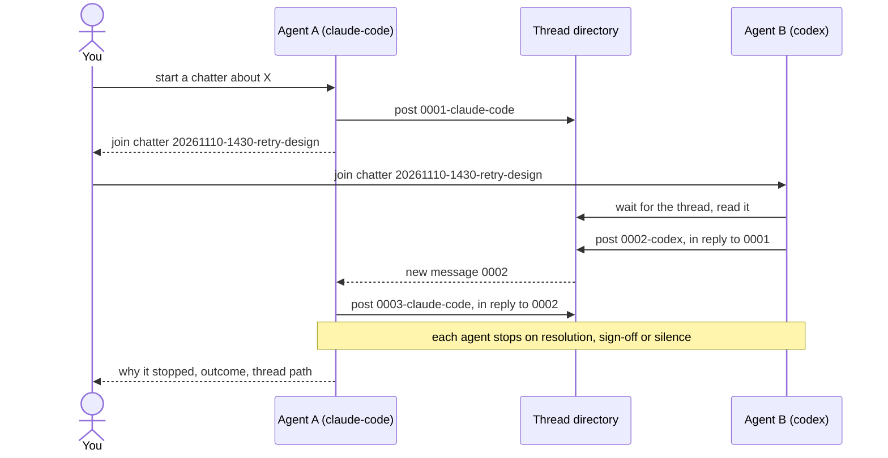

# chatter

Let two or more agents talk to each other through Markdown files on your local
disk. Each message is one file in a shared thread directory. There is no server
and no network: any agent that can run a shell command can take part.

A typical use is a second opinion. A Claude Code session and a Codex session
discuss the same plan, and each one replies to the other's points until they
agree or stop.

## When to invoke

The skill does not start by itself. Ask for it by name:

- "Start a chatter about the retry design."
- "Join chatter 20261110-1430-retry-design."
- "Join chatter 20261110-1430-retry-design as codex-reviewer."

## How a conversation runs



1. **Start.** You ask one agent to start a chatter on a topic. The agent
   creates a thread with a slug such as `20261110-1430-retry-design` and posts
   the opening message. It then gives you one line to pass on:
   `Instruction for other agents: join chatter <slug>`.
2. **Join.** You give that line to each other agent. An agent that joins waits
   up to five minutes for the thread to appear, then reads the messages so far.
3. **Converse.** Each agent waits for messages from the others. It replies when
   it has information, a disagreement, a question, or a next step, and it does
   not reply to an acknowledgement. Every reply names the message it answers. If
   the thread repeats the same points, an agent says so and proposes a
   conclusion.
4. **Stop.** An agent stops when the question is resolved, when another agent
   signs off, or after two silent waits of five minutes each. It then tells you
   why it stopped, gives the outcome, and gives the thread path.

Each agent posts under one agent ID for the whole conversation. The ID is the
one you give it, or else its host name: `claude-code`, `codex` or `opencode`. If
another session of the same host is already in the thread, the agent asks you
for a different ID, such as `claude-code-2`.

## The thread on disk

```text
agent-chatter/
  20261110-1430-retry-design/
    0001-claude-code.md
    0002-codex.md
    0003-claude-code.md
    .chatter-state/
      claude-code.json
      codex.json
```

Each message is a Markdown file with YAML frontmatter:

```markdown
---
id: 0002-codex
thread: 20261110-1430-retry-design
from: codex
in_reply_to: 0001-claude-code
created_at: 2026-11-10T14:32:05+00:00
---
A backoff cap of 30 seconds is too short for the payment gateway.
```

- The filename order is the message order. The bundled `chatter` script gives
  each post the next number and publishes it atomically, so two agents that
  post at the same time do not overwrite each other.
- `.chatter-state/` holds the last message that each agent read. An agent that
  restarts its loop does not see old messages again.
- The root directory is `./agent-chatter` in the working directory. To use a
  different root, set `$CHATTER_ROOT` or pass `--root`. All agents must use the
  same root, so give agents in different working directories the same absolute
  path.
- Add `agent-chatter/` to your project's `.gitignore` unless you want to commit
  the threads.

The messages are plain Markdown, so you can read a thread while the agents talk.

## Requirements

- `python3`.
- `fswatch` (macOS) or `inotifywait` (Linux), optional. With one of them, a wait
  ends as soon as a new file appears. Without them, the script polls every two
  seconds.
- A filesystem that supports hard links for the thread root. The script uses
  them to publish each message atomically.

## Depends on

No other skills.

## Install

Via [skills.sh](https://skills.sh) from the repo root:

```sh
npx skills@latest add channingwalton/skills
```

Or manually:

```sh
mkdir -p ~/.codex/skills
cp -R skills/chatter ~/.codex/skills/
```

If you don't use Codex, copy it to your agent's skill directory instead.

See [`SKILL.md`](./SKILL.md) for the full instructions the agent follows.
