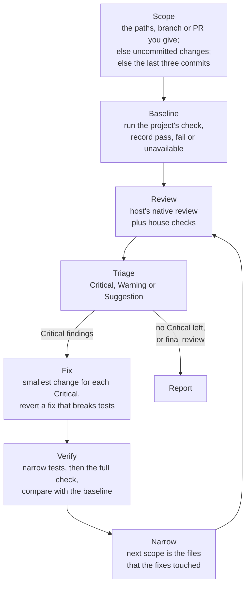

# fix-loop

Review a change, fix its Critical findings, and review it again. The loop stops
when no Critical finding is left, or after five rounds of fixes. It always ends
on a review, so no fix reaches you unreviewed.

A plain code review only reports. fix-loop also repairs, but only the Critical
findings. It reports every other finding and leaves it for you. It never
commits: the caller decides when to commit.

## When to invoke

- "Review and fix this."
- "Find and fix the problems on this branch."
- [`software-development`](../software-development/README.md) runs it as the
  review step of each task.

## How a run goes



- **Scope.** The agent reviews the paths, branch or pull request that you give
  it. With no scope, it takes the uncommitted changes, then the files of the
  last three commits. If neither applies, it asks you.
- **Baseline.** Before it changes anything, the agent runs the project's
  verification command, which it finds in the README, the build scripts, the
  Makefile or similar files. It records the result, so that a later failure can
  be separated from a failure that was there before.
- **Review.** The agent runs the native code review of its host, then the house
  checks below.
- **Triage.** Each finding becomes Critical, Warning or Suggestion. The agent
  settles an uncertain severity with a command, not with an argument. A finding
  that it cannot rule out in one command stays at least a Warning.
- **Fix.** The agent fixes only the Critical findings, with the smallest change
  for each. If a fix breaks tests, the agent reverts only that fix and marks the
  finding unfixable, with the reason.
- **Verify and narrow.** The agent runs the narrowest relevant tests, then the
  full check, and compares the result with the baseline. The next review covers
  only the files that the fixes touched.

After the fifth round of fixes, the agent runs one final review and reports its
Critical findings as unfixed.

## Review on each host

| Host | Review |
|---|---|
| Claude Code | The `code-review` skill, at level `high` in the first round and `medium` after that. |
| Codex | `codex review` with `--uncommitted`, `--base <branch>` or `--commit <sha>`. |
| Other | The house checks are the whole review. |

## House checks

Native reviewers often miss these, so the agent runs them on every host:

- **Test gaps.** New behaviour without a test is Critical.
- **Landing surface.** The agent reads the code around the place where the
  change lands, not only the diff. For example, it reads the authorisation guard
  of a handler that now returns more data, or the code that writes an ID that a
  fix matches on.
- **Changed strings and signatures.** The agent searches the whole repository
  for other uses of the old values, including test assertions.
- **First run.** A migration that can fail on existing production data is
  Critical. For a change that enables a disabled job, trigger or feature flag,
  the agent checks what it does when it first runs.
- **Repro.** Each Critical finding needs a failing test, a REPL snippet, or a
  trace with concrete input values. Without one, it is a Warning.

## The report

Every finding that the reviewer raised appears in the report under exactly one
heading, in the reviewer's words:

- **Resolved**: fixed, with the round that fixed it.
- **Remaining Critical**: not fixed, with the reason.
- **Deferred by user**: left unfixed because you said so, with your words
  quoted.
- **Noted**: Suggestions, Warnings that name no correctness defect, findings on
  code older than the session, and findings that a check ruled out.

A correctness defect that the change introduced is never only Noted. To leave
one unfixed, you must say so explicitly. "Looks good" and "commit it" do not
defer a finding.

The report also gives the number of rounds, and the test status at the baseline
and at the end.

## Depends on

The native code review of the host: the `code-review` skill in Claude Code, or
`codex review` in Codex. On other hosts, the house checks are the whole review.
The repair step is part of the skill.

## Install

Via [skills.sh](https://skills.sh) from the repo root:

```sh
npx skills@latest add channingwalton/skills
```

Or manually:

```sh
mkdir -p ~/.codex/skills
cp -R skills/fix-loop ~/.codex/skills/
```

If you don't use Codex, copy it to your agent's skill directory instead.

See [`SKILL.md`](./SKILL.md) for the full instructions the agent follows.
