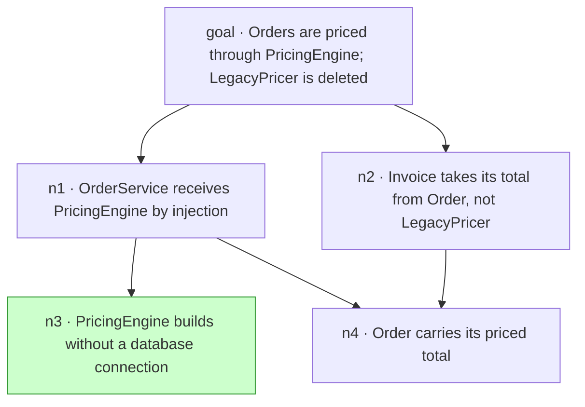

# Mikado

You know the method (Ellnestam and Brolund). This skill fixes how you run it here: you drive the experiments, the graph is a committed file, and every leaf is a commit on a dedicated branch.

The graph can also hold a **choice**: an OR node whose children are different **approaches** to the same outcome. Add a choice only when different approaches could achieve an outcome and the selection could materially change the work. Otherwise, run ordinary Mikado.

The habit to replace is **fixing forward**: chasing breaks until the build goes green, ending with one snowballed diff. In an experiment a break is information. Record that information, then revert.

The graph is the plan. It replaces three parts of your usual development workflow: the separate planning step, the approval before each commit, and the code review after each task. That review runs once, at Finish. Every other rule of that workflow still applies to each leaf, such as its coding conventions and test-first for new behaviour.

## Start

Starting this skill authorises commits on a `mikado/` branch. It does not authorise pushes. If the user did not name Mikado, propose it with the goal and the reason, and wait for a yes before step 1.

1. **State the goal** as one observable outcome, e.g. "Orders are priced through PricingEngine; LegacyPricer is deleted". Record the acceptance criteria that the goal must satisfy, whichever approach achieves it. Derive a short slug from the goal.
2. **Clear the tree**: `git status --porcelain` must be empty, because every experiment reverts to its starting `HEAD`.
   - **A snowballed attempt at this goal** is the first experiment. Build it and run the tests to capture what broke, then put it away recoverably with `git stash push -u -m "mikado: <slug> first attempt"` and carry on. Its breaks seed the graph in step 4, the log names the stash, and so does the final report.
   - **Uncommitted work unrelated to the goal**: stop and ask.
3. **Check the baseline**: run the project's canonical verification command on the clean tree. If it is red, stop and ask, because every experiment would inherit the failure as a false prerequisite.
4. **Branch and graph**: note the base (the current branch and its short commit hash), then run `git switch -c mikado/<slug>`. Create `docs/mikado/<slug>.md` from the template below, with the base, goal, acceptance criteria, any prerequisites that a stashed attempt revealed, and the baseline log line. Commit it as `mikado: start <slug>`.

**Resuming:** the graph file exists only on its branch. Find the run with `git branch --list 'mikado/*'`, and ask if more than one could match. Switch to that branch, then read the graph, the Choices table if there is one, and the log. If the tree is dirty, an experiment was interrupted: show the user the changed files and ask before reverting them. Revalidate the route against the current baseline, then continue at the loop.

## Nodes and edges

Use three kinds of node:

- **Outcome:** an observable state to achieve. The goal and every ordinary prerequisite are outcomes.
- **Choice:** an OR node below an outcome. Its children are approaches to that outcome. A choice has no change of its own.
- **Approach:** one way to achieve the outcome above its choice. That outcome's acceptance criteria are the approach's acceptance criteria. The approach's own prerequisites are the outcomes that this approach needs.

An edge from an outcome or an approach to a prerequisite means AND: every prerequisite must be done. An edge from a choice to an approach means OR: one approach must succeed. An outcome can have common AND prerequisites beside a choice.

The **route** is the part of the graph that the work follows: start at the goal, and at each choice follow only its selected or successful approach.

**Keep prerequisites local to their evidence.** A failure under approach A establishes a prerequisite for A. It does not establish one for the outcome above the choice, or for approach B. Promote a prerequisite to the outcome only when evidence shows that every approach needs it, and log why.

Approaches can come from design reasoning. Prerequisites come only from breaks observed in experiments. An approach that has no probe yet is a candidate, and it has no prerequisites.

Reuse an existing prerequisite when it represents the same state and acceptance criteria. Keep the graph acyclic. A cycle means that the decomposition needs revision.

## The loop

Pick a **ready node** on the route: a node that is not done, whose AND prerequisites are done, and whose choice, if it has one, is done. The first is the goal. After that, prefer the deepest ready node on the route just worked, while its context is fresh.

Read [references/choices.md](references/choices.md) before you add a choice, convert a node to a choice, probe or select an approach, or switch approach. Do this also when the route reaches a choice that has no selected approach. Work on the route only: leave the prerequisites of other approaches alone.

**Experiment.** Start from a clean tree and record the starting commit. Make the node's change directly, the naive way. If the node adds behaviour rather than reshaping code, write a test for that behaviour first and see it fail. Build, then run the tests (a targeted subset when the full suite is slow).

Inside an experiment, finish the node's own follow-through: a rename includes its call sites. For each break, ask: *could this be changed first, on its own, leaving the build green?* If yes, it is a **prerequisite** and becomes a new node. If no, it belongs to this node; fix it within the experiment.

Keep the node's label and acceptance criteria fixed during its experiment, so that a prerequisite cannot become part of the node. When follow-through starts reaching outside the node, it is snowballing. Stop and record.

**A node with no change left.** When a node becomes ready, its outcome can already hold. This is common for an outcome whose only child is a choice, because the successful approach made the change. In that case, run the canonical verification command instead of an experiment, and check the node's acceptance criteria. If both hold, complete the node with the green steps. If they do not hold, run an experiment for the remaining change.

### Green: complete the leaf

1. Run the project's canonical verification command. If it fails, the node is red: record those breaks as below.
2. Confirm that the node's outcome is achieved, and that every AND prerequisite and the choice below it, if any, are done. If the experiment shows that an edge is unnecessary, correct the graph and log the evidence.
3. Mark the node `:::done` and add a log line with verification evidence.
4. If the node is an approach, also mark it successful in the Choices table and mark its choice `:::done`. The choice is now done; it has no experiment of its own. The outcome above the choice becomes ready when its other prerequisites are done. Leave the other approaches in their current status; deferred approaches are not failures.
5. Commit the code and the graph together as `mikado: <node label>`. If the node had no change left, the commit holds only the graph.

### Red: revert, then record

Capture the errors and proposed graph updates before reverting, but commit the graph only after the working tree has been restored.

1. Revert the experiment to its starting commit. When `HEAD` has not moved and all uncommitted files belong to this experiment, use `git reset --hard HEAD && git clean -fd`. Confirm that `git status --porcelain` is empty. If ownership of any changes is uncertain, stop and ask. If the experiment changed dependencies, reinstall so that the next run sees the committed set.
2. Add each prerequisite under the node actually tried: an outcome or an approach. Phrase it as the state that must hold ("OrderService receives PaymentClient by injection"), not as the symptom ("fix error at OrderService.ts:42"). If an existing node already represents that state, link to it.
3. Add a log line: the node tried, the starting commit, what broke (file:line and the error, briefly), and the nodes added.
4. Commit the graph as `mikado: <node id> needs <ids…>`.
5. Continue through those prerequisites. If the evidence suggests a materially different approach to the node, convert the node to a choice, as `references/choices.md` describes.

A failed experiment normally discovers prerequisites. It does not by itself prove that an approach is impossible.

Repeat until the goal is verified done, or a checkpoint requires a decision.

## Checkpoints

You drive, but two things stop you and send the user the graph:

- **A design decision:** materially different options, such as naming a new concept, the shape of an interface, how a dependency is passed, or which approach of a choice to select. Present the options, evidence and prerequisites as they bear on the graph. Bounded reversible probes within the agreed scope can inform the decision; they do not authorise committing a design the user must choose. If the user has **pre-authorised** the work (asked you to land or finish the change, or told you not to wait), settle it yourself instead: choose the smallest reversible option consistent with the evidence, log it as a `decision` line, and list it in the report.
- **Scope:** the route requires changes to another service, a schema, a contract consumed outside the repo, or grows well past what the goal seemed to need. Stop before undertaking those changes, even when the work is pre-authorised. You can mark an approach blocked by scope and continue on an approach that is already authorised. If completing the goal requires broader scope, offer to continue, re-scope the goal, or stop.

The approaches of a choice keep to the user's authorisation and permissions, the same as any other node.

## Finish

1. Verify the goal against its original acceptance criteria. Confirm that every node on the route is done. Deferred approaches can stay incomplete.
2. Review the whole branch against the base in the graph file (`<base>...HEAD`), including any code kept from abandoned approaches. Remove unnecessary residue through verified changes. Commit review fixes as ordinary commits, not as graph nodes.
3. Run the project's canonical verification command after the final changes.
4. Report the final graph (the Mermaid block, copied from the graph file), commits, verification run, selected approaches and reasons, significant deferred or rejected approaches, decisions you settled, and any stash you made. Mention that `docs/mikado/<slug>.md` is still on the branch in case the user wants it dropped before merging.

## Graph file

The Mermaid block holds the structure and the status of each node. The log is the evidence trail: why each prerequisite exists, and why an approach was selected. A run with a choice also has a Choices table; `references/choices.md` gives its format and the extra node styles.

Edges run from a node to its prerequisites, or from a choice to its approaches. Draw outcomes and approaches as rectangles. Draw each choice as a diamond, labelled with its ID and `OR`: `c1{"c1 · OR"}`.

Node IDs are stable once assigned: keep every ID, and never reuse one. To merge two nodes, keep one ID and log which ID merged into it. Keep rejected approaches and their evidence in the graph.

Each node label starts with its ID, so a log line or commit message that cites an ID can be read against the rendered graph. Write labels in plain text, without backticks or embedded double quotes. Use backticks in the log instead. In a message to the user or a note outside the graph file, name a node by its label.

# Graph template

```markdown
# Mikado: <goal>

Branch: `mikado/<slug>`
Base: `<base branch>` at `<short commit>`

## Acceptance criteria

- <Observable outcome required of the goal>
- <Compatibility or behaviour that must be preserved>

## Graph

[Insert Mermaid block here.]

## Log

- baseline: `<verification command>` green at `<short commit>`
- goal at `<commit>`: <failure and location> → n1, n2
- n3 done: `<verification command>` green
```

Example Mermaid block:



This is an illustrative graph. In a real run, add each prerequisite only after an experiment establishes it.
