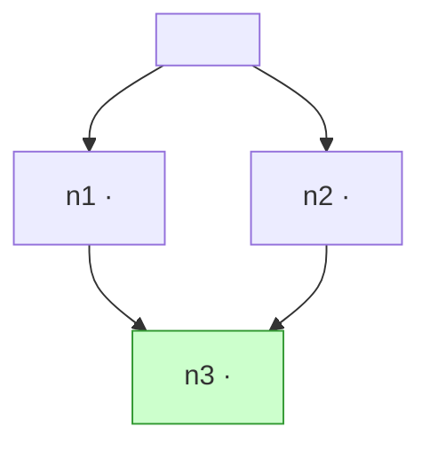

# Mikado

You know the method (Ellnestam and Brolund). This skill fixes how you run it here: you drive the experiments, the graph is a committed file, and every leaf is a commit on a dedicated branch.

The habit to replace is **fixing forward**: chasing breaks until the build goes green, ending with one snowballed diff. In an experiment a break is information. Write it into the graph, then revert.

The graph is the plan. It replaces three parts of your usual development workflow: the separate planning step, the approval before each commit, and the code review after each task. That review runs once, at Finish. Every other rule of that workflow still applies to each leaf, such as its coding conventions and test-first for new behaviour.

## Start

Starting this skill authorises commits on a `mikado/` branch. It does not authorise pushes. If the user did not name Mikado, propose it with the goal and the reason, and wait for a yes before step 1.

1. **State the goal** as one observable outcome, e.g. "Orders are priced through `PricingEngine`; `LegacyPricer` is deleted". Derive a short slug from it.
2. **Clear the tree**: `git status --porcelain` must be empty, because every revert resets to `HEAD`.
   - **A snowballed attempt at this goal** is the first experiment. Build it and run the tests to capture what broke, then put it away recoverably with `git stash push -u -m "mikado: <slug> first attempt"` and carry on. Its breaks seed the graph in step 4, the log names the stash, and so does the final report.
   - **Uncommitted work unrelated to the goal**: stop and ask.
3. **Check the baseline**: run the project's canonical verification command on the clean tree. If it is red, stop and ask, because every experiment would inherit the failure as a false prerequisite.
4. **Branch and graph**: note the base (the current branch and its short commit hash), then run `git switch -c mikado/<slug>`. Create `docs/mikado/<slug>.md` from the template below, with the base, the goal node, any prerequisites that a stashed attempt revealed, and the baseline log line. Commit it as `mikado: start <slug>`.

**Resuming:** the graph file exists only on its branch. Find the run with `git branch --list 'mikado/*'`, and ask if more than one could match. Switch to that branch, then read the graph and the log. If the tree is dirty, an experiment was interrupted: show the user the changed files and ask before you revert them. Then continue at the loop.

## The loop

Pick a **ready node**: one that isn't done and whose prerequisites are all done. The first is the goal. After that, prefer the deepest ready node on the branch of the graph you just worked, while its context is fresh.

**Experiment.** Make that node's change directly, the naive way. If the node adds behaviour rather than reshaping code, write a test for that behaviour first and see it fail. Build, then run the tests (a targeted subset when the full suite is slow).

Inside an experiment, finish the node's own follow-through: a rename includes its call sites. For each break, ask: *could this be changed first, on its own, leaving the build green?* If yes, it is a **prerequisite** and becomes a new node. If no, it belongs to this node; fix it within the experiment. A change that other nodes also need counts as a break: it is a prerequisite of each of them. Record it as its own node, with an edge to it from each node that needs it. Keep the node's label fixed during its experiment, so that a prerequisite cannot become part of the node. When follow-through starts reaching outside the node, it is snowballing. Stop and record.

**Green: complete the leaf.**

1. Run the project's canonical verification command. If it fails, the node is red: record those breaks as below.
2. Confirm that every node this node points to is done. If one is not, an edge is wrong: correct the graph and log the correction.
3. Mark the node `:::done`, add a log line, and commit code and graph together as `mikado: <node label>`.

**Red: revert, then record.** Revert first, so that the graph commit runs on a clean tree and passes any pre-commit hook. The breaks stay in your context.

1. Revert: `git reset --hard HEAD && git clean -fd`, then confirm `git status --porcelain` is empty. If the experiment changed dependencies, reinstall so the next run sees the committed set.
2. Add each prerequisite as a node under the one you tried. A prerequisite comes only from a break in an experiment, not from a reading of the code. Phrase it as the state that must hold ("`OrderService` receives `PaymentClient` by injection"), not as the symptom ("fix error at OrderService.ts:42"). If an existing node already says it, link to that node instead, because the graph is a DAG.
3. Add a log line: the node tried, what broke (file:line and the error, briefly), and the nodes added.
4. Commit the graph: `git commit -m "mikado: <node id> needs <ids…>" -- docs/mikado/<slug>.md`.

Repeat until the goal node is done.

## Checkpoints

You drive, but two things stop you and send the user the graph:

- **A design decision**: a node with materially different options, such as naming a new concept, the shape of an interface, or how a dependency is passed. Present the options as they bear on the graph. If the user has **pre-authorised** the work (asked you to land or finish the change, or told you not to wait), settle it yourself instead: take the smallest reversible option, log it as a `decision` line, and list it in the report.
- **Scope**: the graph outgrows the goal, with prerequisites reaching another service, a schema, a contract consumed outside the repo, or growing well past what the goal seemed to need. This stops you even when the work is pre-authorised, because it changes what the user agreed to. Offer to continue, re-scope the goal, or stop. Every commit so far is green, so stopping is safe.

## Finish

1. Review the whole branch against the base in the graph file (`<base>...HEAD`), and fix what the review finds. Commit the fixes as ordinary commits, not as graph nodes.
2. Report the final graph (the Mermaid block, copied from the graph file), the commits, the verification run, any decisions you settled, and any stash you made. Mention that `docs/mikado/<slug>.md` is still on the branch in case the user wants it dropped before merging.

## Graph file

The Mermaid block holds the structure and status. The log is the evidence trail: why each node exists. Edges run from a node to its prerequisites. Node IDs are stable once assigned: keep every ID, and never reuse one. To merge two nodes, keep one ID and log which ID merged into it. Each prerequisite label starts with its ID, so a log line or a commit message that cites an ID can be read against the rendered graph. Write each label in plain text, without backticks or double quotes: Mermaid fails on a backtick directly after the opening quote, and a double quote ends the label. Use backticks in the log instead. In a message to the user or a note outside the graph file, name a node by its label.

````markdown
# Mikado: <goal>

Branch: `mikado/<slug>`
Base: `<base branch>` at `<short commit>`



## Log

- baseline: `<verification command>` green at `<short commit>`
- goal tried: `PricingEngine` not constructible in `OrderService` (OrderService.ts:42); `LegacyPricer` used by `Invoice` (Invoice.ts:17) → n1, n2
- n1 tried: … → n3
- decision (n3): `PaymentClient` passed as the first constructor parameter; alternative was a factory
- n3 done
````
