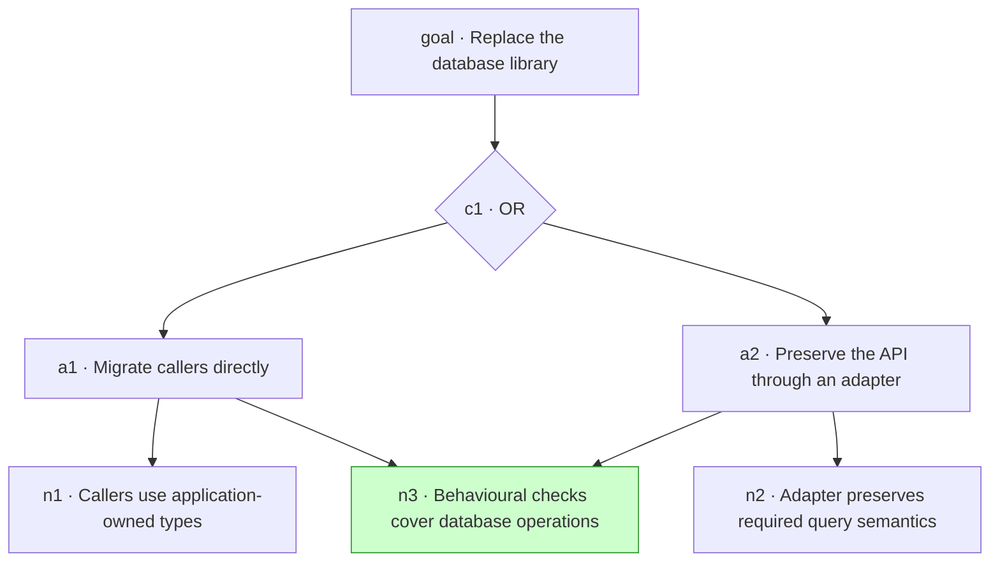

# Mikado

You know the method (Ellnestam and Brolund). This skill fixes how you run it here: you drive the experiments, the graph is a committed file, and every leaf is a commit on a dedicated branch.

Extend the usual prerequisite graph with OR choices when genuinely different approaches could achieve the same outcome. Retain ordinary Mikado when one approach is sufficient.

The habit to replace is **fixing forward**: chasing breaks until the build goes green, ending with one snowballed diff. In an experiment a break is information. Record that information, then revert.

The graph is the plan. It replaces three parts of your usual development workflow: the separate planning step, the approval before each commit, and the code review after each task. That review runs once, at Finish. Every other rule of that workflow still applies to each leaf, such as its coding conventions and test-first for new behaviour.

## Start

Starting this skill authorises commits on a `mikado/` branch. It does not authorise pushes. If the user did not name Mikado, propose it with the goal and the reason, and wait for a yes before step 1.

1. **State the goal** as one observable outcome, e.g. "Orders are priced through PricingEngine; LegacyPricer is deleted". Record acceptance criteria that every alternative must satisfy. Derive a short slug from the goal.
2. **Clear the tree**: `git status --porcelain` must be empty, because every experiment reverts to its starting `HEAD`.
   - **A snowballed attempt at this goal** is the first experiment. Build it and run the tests to capture what broke, then put it away recoverably with `git stash push -u -m "mikado: <slug> first attempt"` and carry on. Its breaks seed the graph in step 4, the log names the stash, and so does the final report.
   - **Uncommitted work unrelated to the goal**: stop and ask.
3. **Check the baseline**: run the project's canonical verification command on the clean tree. If it is red, stop and ask, because every experiment would inherit the failure as a false prerequisite.
4. **Branch and graph**: note the base (the current branch and its short commit hash), then run `git switch -c mikado/<slug>`. Create `docs/mikado/<slug>.md` from the template below, with the base, goal, acceptance criteria, any prerequisites that a stashed attempt revealed, and the baseline log line. Commit it as `mikado: start <slug>`.

**Resuming:** the graph file exists only on its branch. Find the run with `git branch --list 'mikado/*'`, and ask if more than one could match. Switch to that branch, then read the graph, choices and log. If the tree is dirty, an experiment was interrupted: show the user the changed files and ask before reverting them. Revalidate the selected route against the current baseline, then continue at the loop.

## AND prerequisites and OR approaches

Use three kinds of node:

- **Outcome:** an observable state to achieve, including the goal and ordinary prerequisites.
- **Choice:** an OR junction whose children are alternative approaches to the same outcome.
- **Approach:** one way to achieve the outcome. Its outgoing edges are AND prerequisites required by that approach.

Ordinary outgoing prerequisite edges mean **AND**: all must be satisfied. Only an explicitly labelled OR junction means **OR**: one approach must succeed. A parent may have common AND prerequisites alongside an OR choice.

An approach is not complete merely because its prerequisites are complete. Implement and verify the approach against its parent outcome. Likewise, verify the parent before marking it done; never propagate completion solely from graph structure.

**Keep prerequisites local to their evidence.** A failure under approach A establishes a prerequisite for A, not automatically for the parent outcome or approach B. Promote it to a common prerequisite only when evidence supports that relationship, and log why.

Alternatives may be proposed from design reasoning. Prerequisite nodes must still come from breaks observed in experiments. Label untested alternatives as candidates; do not invent their dependency graphs.

Reuse an existing prerequisite when it represents the same state and acceptance criteria. Keep the graph acyclic. A cycle means the decomposition needs revision, not that the agent should recurse indefinitely.

## The loop

Follow the selected route through each OR choice. Pick a **ready node** on that route: one that is not done and whose AND prerequisites and required OR choices are satisfied. The first is the goal. After that, prefer the deepest ready node on the route just worked, while its context is fresh.

If the route contains an unresolved OR choice, resolve or probe that choice using the procedure below before proceeding through it. Do not implement prerequisites belonging only to an unselected alternative.

**Experiment.** Start from a clean tree and record the starting commit. Make the node's change directly, the naive way. If the node adds behaviour rather than reshaping code, write a test for that behaviour first and see it fail. Build, then run the tests (a targeted subset when the full suite is slow).

Inside an experiment, finish the node's own follow-through: a rename includes its call sites. For each break, ask: *could this be changed first, on its own, leaving the build green?* If yes, it is a **prerequisite** and becomes a new node. If no, it belongs to this node; fix it within the experiment.

Keep the node's label and acceptance criteria fixed during its experiment, so that a prerequisite cannot become part of the node. When follow-through starts reaching outside the node, it is snowballing. Stop and record.

### Green: complete the leaf

1. Run the project's canonical verification command. If it fails, the node is red: record those breaks as below.
2. Confirm that the node's outcome is achieved, every AND prerequisite is done, and every required OR choice has a verified successful approach. If the experiment shows an edge is unnecessary, correct the graph and log the evidence.
3. Mark the node `:::done`, add a log line with verification evidence, and commit code and graph together as `mikado: <node label>`.
4. If it completes an approach, record that approach as successful and recheck its parent outcome. Mark the parent done only when its own acceptance criteria hold. Leave unused alternatives deferred; they are not failures.

### Red: revert, then record

Capture the errors and proposed graph updates before reverting, but commit the graph only after the working tree has been restored.

1. Revert the experiment to its starting commit. When `HEAD` has not moved and all uncommitted files belong to this experiment, use `git reset --hard HEAD && git clean -fd`. Confirm `git status --porcelain` is empty. If ownership of any changes is uncertain, stop and ask. If the experiment changed dependencies, reinstall so the next run sees the committed set.
2. Add each prerequisite under the node or approach actually tried. Phrase it as the state that must hold ("OrderService receives PaymentClient by injection"), not as the symptom ("fix error at OrderService.ts:42"). If an existing node already represents that state, link to it.
3. Add a log line: the node and approach tried, starting commit, what broke (file:line and the error, briefly), and the nodes added.
4. Commit the graph as `mikado: <node id> needs <ids…>`.
5. Continue through those prerequisites, or consider an OR choice if the evidence suggests a materially different route.

A failed experiment normally discovers prerequisites. It does not by itself prove that an approach is impossible.

Repeat until the goal is verified done, or a checkpoint requires a decision.

## Exploring OR choices

Introduce an OR choice when different approaches could satisfy the same outcome and choosing between them could materially change the work. Do not add alternatives merely to fill the graph.

When converting an existing node to a choice, preserve its outcome and ID. Move prerequisites discovered by its earlier attempt under an approach representing that attempt. Retain common prerequisites on the parent only where supported by evidence. Log the restructuring.

### Bound exploration

For each choice:

1. State the outcome and acceptance criteria shared by all alternatives.
2. List the plausible approaches, normally two or three.
3. Rank them using available evidence: scope, reversibility, compatibility, likely effort and unresolved uncertainty.
4. Record an exploration budget and a stopping condition before probing.

Unless the task suggests a better budget, probe at most two approaches initially, with one bounded experiment per approach. Give each probe a concrete limit, such as ten minutes of editing followed by the relevant verification. A slow verification command may finish; do not use that as permission to keep editing.

Stop exploration when an approach has enough evidence to justify selection. It is not necessary to test every candidate.

### Probe alternatives

Probe sequentially on the dedicated branch by default. OR expresses a choice, not an instruction to execute concurrently.

For each probe:

1. Record its baseline, uncertainty to resolve, budget and success criterion.
2. Attempt the approach without recursively implementing its newly discovered prerequisites.
3. Capture verification results, discovered prerequisites and remaining uncertainty.
4. Revert experimental changes before probing another approach.
5. Commit the findings and graph changes on the restored baseline.

A green probe may become the selected implementation and be committed using the green procedure, provided the choice is within existing authority. Otherwise revert it and retain the findings.

If parallel exploration is explicitly requested, use isolated worktrees with a recorded common baseline. Do not combine implementations automatically.

### Select and commit to a route

Record each alternative as one of:

- **candidate:** proposed, not yet investigated;
- **selected:** the current route for implementation;
- **deferred:** retained as a fallback;
- **blocked:** an identified obstacle currently prevents progress;
- **rejected:** evidence shows it violates the outcome or constraints;
- **successful:** implemented and verified against the outcome.

Keep at most one selected approach per choice. Record the selection, evidence and remaining uncertainty in the Choices section. Apply the design-decision checkpoint before committing to materially different designs.

Budget exhaustion means uncertainty remains; mark the alternative deferred or blocked with the reason. Do not call it rejected solely because its probe ran out of time.

After selection, resume the normal Mikado loop through that approach's prerequisites. Do not switch routes merely because implementation becomes difficult. Switch when new evidence materially changes the comparison, a stopping condition is reached, or the selected route is blocked. Record the reason.

### Switch without losing valid work

Before switching:

1. Revert any uncommitted experiment.
2. Inspect completed commits from the previous route. Keep changes that remain valid and useful; do not reset away green commits.
3. If route-specific committed changes conflict with the new route, plan their removal as explicit, verified changes. Preserve history and unrelated work.
4. Reassess the new route from the resulting baseline. Earlier probe results may be stale.
5. Update the selected and deferred statuses and log the transition.

If every known alternative is blocked or rejected, report the evidence. Propose a new approach only when there is a concrete reason it could help; do not expand the graph indefinitely.

## Checkpoints

You drive, but two things stop you and send the user the graph:

- **A design decision:** materially different options, such as naming a new concept, the shape of an interface, or how a dependency is passed. Present the alternatives, evidence and prerequisites as they bear on the graph. Bounded reversible probes within the agreed scope may inform the decision; they do not authorise committing a design the user must choose. If the user has **pre-authorised** the work (asked you to land or finish the change, or told you not to wait), settle it yourself instead: choose the smallest reversible approach consistent with the evidence, log it as a `decision` line, and list it in the report.
- **Scope:** the selected route requires changes to another service, a schema, a contract consumed outside the repo, or grows well past what the goal seemed to need. Stop before undertaking those changes, even when the work is pre-authorised. An alternative may be marked blocked by scope while an already authorised route continues. If completing the goal requires broader scope, offer to continue, re-scope the goal, or stop.

OR alternatives do not expand the user's authorisation or bypass permissions.

## Finish

1. Verify the goal against its original acceptance criteria. Confirm that the selected route is complete and no required prerequisite remains unresolved. Deferred alternatives need not be completed.
2. Review the whole branch against the base in the graph file (`<base>...HEAD`), including any code retained from abandoned routes. Remove unnecessary residue through verified changes. Commit review fixes as ordinary commits, not as graph nodes.
3. Run the project's canonical verification command after the final changes.
4. Report the final graph (the Mermaid block, copied from the graph file), commits, verification run, selected approaches and reasons, significant deferred or rejected alternatives, decisions you settled, and any stash you made. Mention that `docs/mikado/<slug>.md` is still on the branch in case the user wants it dropped before merging.

## Graph file

The Mermaid block holds the structure and completed-node status. The Choices section records alternative status, selection and budgets. The log is the evidence trail: why each prerequisite exists and why a route was chosen.

Edges run from a node to its prerequisites, or from an OR junction to its approaches. Label every OR junction explicitly. All other prerequisite edges mean AND.

Node IDs are stable once assigned: keep every ID, and never reuse one. To merge two nodes, keep one ID and log which ID merged into it. Do not silently delete rejected alternatives or their evidence.

Each node label starts with its ID, so a log line or commit message that cites an ID can be read against the rendered graph. Write labels in plain text, without backticks or embedded double quotes. Use backticks in the log instead. In a message to the user or a note outside the graph file, name a node by its label.

Use the structure below only where alternatives exist. For a straightforward run, omit the OR junction, approach nodes and Choices section.

# Graph template

```markdown
# Mikado: <goal>

Branch: `mikado/<slug>`
Base: `<base branch>` at `<short commit>`

## Acceptance criteria

- <Observable outcome required of every approach>
- <Compatibility or behaviour that must be preserved>

## Graph

[Insert Mermaid block here.]

## Choices

| Choice | Approach | Status | Evidence / reason |
|---|---|---|---|
| c1 | a1 | selected | <Evidence supporting selection> |
| c1 | a2 | deferred | <Uncertainty or reason for retaining as fallback> |

Exploration budget for c1: <number of probes and limit per probe>.
Stop exploring when: <evidence sufficient to select a route>.
Reconsider selection when: <material new evidence or blocker>.

## Log

- baseline: `<verification command>` green at `<short commit>`
- probe (a1) at `<commit>`: <failure and location> → n1
- probe (a2) at `<commit>`: <failure and location> → n2
- shared prerequisite (n3): <evidence that both approaches require the same state>
- decision (c1): select a1 because <evidence>; retain a2 as fallback
- n3 done: `<verification command>` green
```

Example Mermaid block:



This is an illustrative graph. In a real run, add each prerequisite only after an experiment establishes it.
