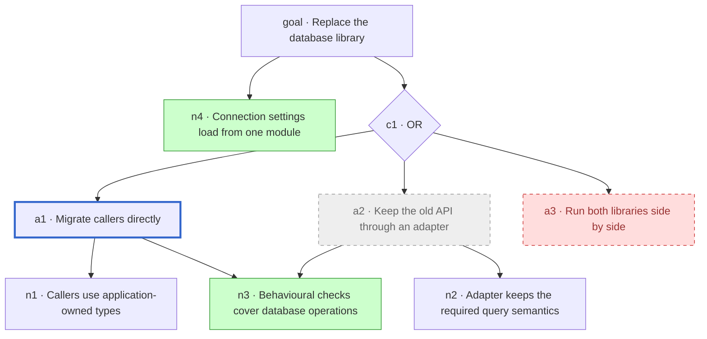

# Choices

This file extends the Mikado skill for a graph that holds a choice. `SKILL.md` defines the terms outcome, choice, approach and route, and completes a successful approach in Green step 4.

## Add a choice

Add a choice when different approaches could achieve the same outcome and the selection could materially change the work. List only plausible approaches, normally two or three.

To add a choice to an outcome, add a choice node below the outcome, and add each approach below the choice. The outcome keeps its other AND prerequisites beside the choice.

To convert an existing node to a choice:

1. Keep the node's outcome and ID.
2. Add a choice below the node.
3. Add an approach that represents the earlier attempt, and move the prerequisites that the attempt found under that approach.
4. Keep a prerequisite on the outcome only where evidence shows that every approach needs it.
5. Log the restructuring.

## Bound the exploration

For each choice, before the first probe:

1. State the outcome and the acceptance criteria that every approach must satisfy.
2. List the plausible approaches.
3. Rank them on the available evidence: scope, reversibility, compatibility, likely effort and unresolved uncertainty.
4. Record an exploration budget and a stopping condition in the Choices section.

Unless the task suggests a better budget, probe at most two approaches at first, with one probe per approach. Give each probe a concrete limit, such as ten minutes of editing followed by the relevant verification. A slow verification command can finish after the limit, but the editing stops at the limit.

Stop exploration when one approach has enough evidence to justify selection. Not every candidate needs a probe.

## Probe approaches

A **probe** is a bounded experiment on one approach. Probe one approach at a time, on the `mikado/` branch. A choice means OR; it does not mean concurrent work.

For each probe:

1. Record its starting commit, the uncertainty to resolve, the budget and the success criterion.
2. Attempt the approach. Record its newly discovered prerequisites, but do not implement them during the probe.
3. Capture the verification results, the discovered prerequisites and the remaining uncertainty.
4. Revert the probe, as Red step 1 in `SKILL.md` describes.
5. Commit the findings and the graph changes on the restored tree.

If a probe is green, and selecting that approach is within the user's authorisation, you can keep it: select the approach and complete it with the green steps. Otherwise, revert it and keep the findings.

If the user explicitly asks for parallel probes, use isolated worktrees from one recorded starting commit. Keep each probe's changes in its own worktree; the user decides how to combine them.

## Select an approach

Give each approach one status:

- **candidate:** proposed, with no probe yet.
- **selected:** the approach on the current route.
- **deferred:** kept as a fallback.
- **blocked:** an identified obstacle prevents progress now.
- **rejected:** evidence shows that it violates the outcome or the constraints.
- **successful:** implemented and verified against the outcome.

Keep at most one selected approach per choice. Record the selection, the evidence and the remaining uncertainty in the Choices table. Apply the design-decision checkpoint in `SKILL.md` before you commit to an approach with a materially different design.

An exhausted budget means that uncertainty remains. Mark the approach deferred or blocked, with the reason. Mark an approach rejected only when evidence shows that it violates the outcome or the constraints.

After selection, return to the loop in `SKILL.md` and work through the prerequisites of the selected approach. Keep the selected approach when implementation becomes difficult. Switch approach only when one of these occurs, and log the reason:

- New evidence materially changes the comparison.
- A recorded stopping condition is reached.
- The selected approach is blocked.

## Switch approach

Keep valid work when you switch:

1. Revert any uncommitted experiment.
2. Inspect the commits of the previous approach. Keep the changes that remain valid and useful, and keep every green commit in the history.
3. If committed changes of the previous approach conflict with the new approach, remove them through explicit, verified changes. Preserve history and unrelated work.
4. Reassess the new approach from the resulting commit. Earlier probe results can be stale.
5. Update the statuses in the Choices table and the graph, and log the switch.

If every known approach is blocked or rejected, report the evidence to the user. Propose a new approach only when there is a concrete reason that it could help.

## Graph notation

Give each approach the class of its status, so that the rendered graph shows each dead or parked approach:

| Status | Class |
|---|---|
| candidate | none |
| selected | `selected` |
| deferred | `deferred` |
| blocked | `blocked` |
| rejected | `rejected` |
| successful | `done` |

A choice gets `done` in the commit that makes one of its approaches successful. Change an approach's class and its Choices table row in the same commit. The table holds the evidence; the class only shows the status.

Put the Choices section between the Graph and the Log in the graph file:

```markdown
## Choices

| Choice | Approach | Status | Evidence / reason |
|---|---|---|---|
| c1 | a1 | selected | <Evidence that supports the selection> |
| c1 | a2 | deferred | <Uncertainty, or the reason to keep it as a fallback> |
| c1 | a3 | rejected | <Evidence that it violates the outcome or a constraint> |

Exploration budget for c1: <number of probes and the limit per probe>.
Stop exploring when: <evidence sufficient to select an approach>.
Reconsider the selection when: <material new evidence or a blocker>.
```

Log lines for a choice:

```markdown
- probe (a1) at `<commit>`: <failure and location> → n1
- probe (a2) at `<commit>`: <failure and location> → n2
- probe (a3) at `<commit>`: <evidence> → rejected
- common prerequisite (n3): <evidence that both a1 and a2 need the same state>
- decision (c1): select a1 because <evidence>; keep a2 as a fallback
- n3 done: `<verification command>` green
```

Example Mermaid block. The goal has a common AND prerequisite, n4, beside the choice c1. The prerequisite n3 is common to a1 and a2.



This is an illustrative graph. In a real run, add each prerequisite only after an experiment establishes it.
