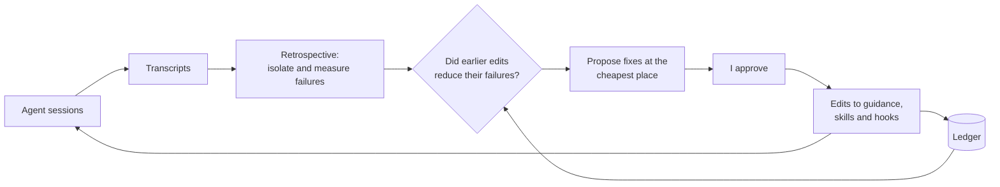

# retrospective

A cross-session improvement loop for harness configuration: reduce **mistakes,
wasted human attention, and restarts** in future sessions by improving the
skills and config they run under. Distils several session transcripts into
structured notes, measures **how often you had to correct the agent** and
**accepted changes per human hour**, proposes config edits placed at the **cheapest-to-run actuator**
that prevents each failure, and **verifies**
that prior retros' edits actually reduced the cost they targeted before
proposing more.

It is a closed control loop: sessions are the only sensor; the actuators are the
things a proposed fix *could* change (gates and hooks, skills, commands, agents,
config, tool surface, standing context like CLAUDE.md / AGENTS.md) — a menu of
where a fix can land, not a list of what this skill ships. Two things are explicitly
not actuators and never the proposed fix: the model itself, and the task
distribution.



See [`SKILL.md`](./SKILL.md) for the process, actuator ordering, sort table,
output shape, and red flags. Per-step detail is progressively disclosed — each
file is read at its step, and on a given run two of the five often are not opened
at all:

| File | Read at |
|---|---|
| [`references/distil.md`](./references/distil.md) | DISTIL — failure isolation, availability tags, capture list. Self-contained, so it can be handed to a distil subagent on its own. |
| [`references/corrections.md`](./references/corrections.md) | MEASURE — what counts as a correction, human hours, accepted changes, manual cost-per-failure method. |
| [`references/context-audit.md`](./references/context-audit.md) | MEASURE — measurement traps, noise heuristics, restart detection. |
| [`retro.py`](./retro.py) | MEASURE — the bundled script: `measure`, `context` and `restarts`. Stdlib-only Python 3, tested by `test_retro.py`. |
| [`references/verify.md`](./references/verify.md) | VERIFY — excitation, presence, replay, cost and trend checks. Skipped entirely on a first run. |
| [`references/ledger.md`](./references/ledger.md) | APPLY — the three ledger row formats. Needed only once the user approves. |

## When to invoke

- Fortnightly / end of a milestone / "let's do a retro"
- "What's been recurring?" / "what did we learn?" / "review the last few sessions"
- "How well have the skills been working lately?"

Not for single-session end-of-task review or mid-task check-ins. The unit of
analysis is several sessions, not one.

## What it does differently from a plain retro

- **Weighted by your corrections, not by tokens.** Your attention is the
  bottleneck; agent tokens are cheap. The headline is how often you had to
  correct the agent — changes you read and rejected, rework that came back to
  you, decisions you made twice, redirects, interrupts — so one failure you
  corrected four times outweighs a tail of papercuts the agent fixed alone.
  Questions the agent puts to you are a guard, so an edit cannot hide
  corrections as questions. Wrong-outcome mistakes keep standing regardless of
  cost. Tokens stay as a diagnosis: they explain truncation, compaction and
  session limits. Throughput is accepted changes per human hour.
- **Restart-aware.** A session you abandoned and re-prompted fresh is the most
  expensive failure shape, and per-session analysis can't see it; an aggregate
  pass looks for re-attempted tasks across transcripts.
- **Actuator placement.** Each fix goes to the lowest-costing actuator that
  prevents it (a gate that costs nothing until it fires beats a CLAUDE.md line
  that taxes every session, and a gate that blocks beats one that asks you). It
  resists answering failures with more standing context.
- **Closed loop.** It keeps a small ledger of the edits it applies and checks,
  next time, whether each edit stuck and whether the failure it targeted got
  cheaper — so corrections are verified, not assumed. The ledger also gets one
  summary row per retro (window headline plus cumulative edit hit-rate), so the
  retro audits *itself*: a high ineffective or never-exercised rate, or waste
  that stays flat despite confirmed edits, is a finding about the retro.
- **Replay where replay is possible.** Waiting a window to see whether a failure
  got cheaper is weak attribution — the task mix moves underneath you. Where a
  failure is mechanically checkable and free of side effects (tool loading,
  gating, path handling — the harness-shaped ones), VERIFY re-runs the trigger
  instead of waiting, and reports whether a verdict was replayed or merely
  observed. Most work is not replayable; the skill says so rather than
  pretending otherwise.
- **Remembers what it rejected.** Declined proposals and reverted edits get
  their own ledger rows, so a later retro does not re-raise a decision already
  made — and so a failure class carries the record of which actuators have
  already been tried against it and failed.

## Install

Via [skills.sh](https://skills.sh) from the repo root:

```sh
npx skills@latest add channingwalton/skills
```

Or manually:

```sh
mkdir -p ~/.codex/skills
cp -R skills/retrospective ~/.codex/skills/
```

Substitute your agent's skill directory if not Codex.

Then point the retro at a durable ledger file so it can verify its own edits
across runs (see [Persistence](#persistence)):

```sh
export RETROSPECTIVE_LEDGER=~/path/to/retro-ledger.md   # add to your shell profile
```

If unset, the retro asks for the location on first run.

## Persistence

The retro prints inline. It writes only two things to disk:

1. **Per-session intermediate notes** — into a throwaway tmp dir (`mktemp -d`).
   Discarded after the run.
2. **The VERIFY ledger** — a small durable file the retro writes to itself at
   APPLY and reads at the next retro. Three row types. One per applied edit:
   what changed, which actuator, the failure class it targets, the edit's
   `after` text verbatim (used next time to check the edit is still in force),
   and optionally a config fingerprint. One per **rejected** proposal — declined
   at CONFIRM, or reverted at VERIFY as ineffective or refuted by replay — with
   the reason, which PROPOSE reads next time so it does not re-raise a settled
   decision. Plus one summary row per retro run —
   window headline (correction rate, question rate, accepted changes per
   human hour, wasted tokens, restarts, wrong-outcome mistakes) and edit
   hit-rate to date — which the next retro reads as a trend check on the retro
   itself. It must persist across sessions and live
   somewhere read only at retro time — never injected into a working session's
   context. The skill does not prescribe a location or storage format. It finds
   the ledger from **`$RETROSPECTIVE_LEDGER`** (a file path); if that is unset it
   asks where to keep it on first run. Either way it works the same whether or
   not the files it edits are version-controlled (it uses the stored `after`
   text, not a VCS, to verify an edit survived).

On the **first run** (no ledger yet) VERIFY is skipped and the ledger is created
at APPLY — at `$RETROSPECTIVE_LEDGER` if set, otherwise a location you confirm.

There is deliberately **no on-the-fly hook** writing observations during
sessions: the transcript is already the complete on-the-fly record, and an
in-session writer would spend live tokens in the very sessions the retro exists
to make cheaper. To flag something for the next retro mid-session, just say
"remember X for retro" — it lands in the transcript and DISTIL picks it up. The
agent's own in-session "that was wrong" recognitions are harvested the same way.

Session transcripts (the input) live in different places per agent and host —
the skill asks where they are if the location isn't obvious. If they aren't
available as raw JSONL, the MEASURE step skips `retro.py` (the rest still
runs).
