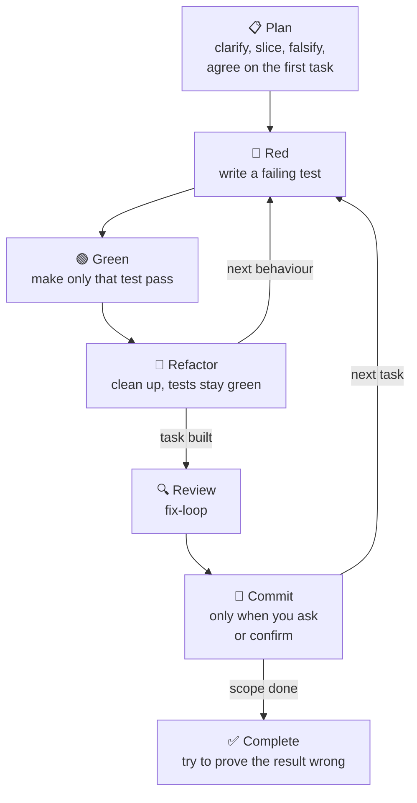

# software-development

An Extreme Programming (XP) workflow for an agent that writes production code.
The agent plans the work as small vertical slices, builds each slice
test-first, reviews it, and then tries to prove the result wrong before it
calls the work done.

The skill stops two habits: going straight to edits without a plan, and
reporting "done" because the build is green.

It applies to the source and tests of an application or a library. The agent
edits scripts, build, deployment and CI configuration directly, outside this
workflow, because an error in that code shows at once when it runs.

This is the reverse of [`pair-programming`](../pair-programming/README.md),
where you build and the agent is your pair.

## When to invoke

The skill starts by itself when a task implements, fixes or refactors behaviour
in production code. You can also ask for it:

- "Use software-development to add a CSV export."
- "Fix this bug with the software-development workflow."

## How a task goes



- **Plan.** The agent first reads the context, such as the ticket and its
  parent tickets. For work that is ambiguous, user-facing, multi-step or risky,
  it plans before it writes code:
  1. Find the real outcome and the code that it affects.
  2. Restate the requirement as "Given [premises], then [conclusion]", and ask
     about the premises that nobody stated.
  3. Slice the work into small tasks by visible behaviour, not by layer.
  4. Ask what would prove this understanding wrong. Settle each question with
     the cheapest evidence: read the code for a fact about the system, ask you
     for a fact about intent, and write a failing test for new behaviour.
  5. Show you the ordered tasks, and agree on the first one before any code.

  For a small, explicit fix, the plan is short and the agent goes to the first
  test.
- **Red, Green, Refactor.** For each behaviour, the agent writes a failing
  test, makes the smallest change that passes it, and then cleans up while the
  tests stay green. It makes no edits to nearby code that the test does not
  need. When it changes a public signature, it reads every caller.
- **Review.** The agent runs [`fix-loop`](../fix-loop/README.md) on each task.
  It skips the review only for a change with no code, or for one line of build
  or configuration wiring, and it says when it skips.
- **Commit.** The agent commits only when you ask or confirm. First, it checks
  the status and the diff, runs the project's verification command, and shows
  you what it will commit. It never commits on red, and never pushes without a
  green check.
- **Complete.** For each behaviour that it calls done, the agent names the
  check that would prove the claim false, and runs it against the real output:
  the rendered page, the served response, or the actual file. A green test suite, a
  mock or a re-read of the code is not enough. A behaviour that it cannot check
  is reported as **unverified**, not done.

## Definition of Done

A task is done only when all of these are true:

- New behaviour has new tests.
- The tests of the affected module are green.
- `fix-loop` is clean, or the agent stated why it skipped the review.
- For a UI or runtime change, the agent used the changed behaviour in the
  running app, or reported it as unverified.

## Grounding checks

Before the agent relies on a claim, it checks the claim against the source of
truth. Some examples:

- A note or ticket that says how the code works is checked against the code.
- A passed test counts only if it fails when the new behaviour is removed.
- A rename is done only when a search finds no use of the old name in code,
  documentation or README.
- A command's output is proof only through a positive marker, such as a test
  count, never through the absence of an error message.

## Depends on

- [`fix-loop`](../fix-loop/README.md) for the review step.
- A language skill for Red and Green when one is installed, such as
  `scala-developer` or `unison-development`. These are not published here.

## Install

Via [skills.sh](https://skills.sh) from the repo root:

```sh
npx skills@latest add channingwalton/skills
```

Or manually:

```sh
mkdir -p ~/.codex/skills
cp -R skills/software-development ~/.codex/skills/
```

If you don't use Codex, copy it to your agent's skill directory instead.

See [`SKILL.md`](./SKILL.md) for the full instructions the agent follows, and
[`references/`](./references/) for the planning and development detail.
